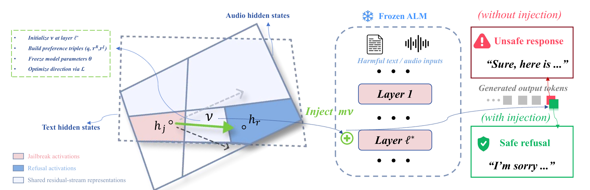
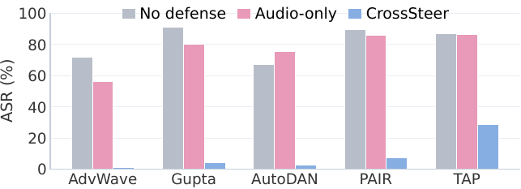

<div align="center">

# CrossSteer: Cross-Modal Safety Steering for Audio-Language Models

**Houde Dong<sup>1</sup>, Weifei Jin<sup>1</sup>, Yuxin Cao<sup>2</sup>, Wei Song<sup>3</sup>, Derui Wang<sup>4</sup>, Jie Hao<sup>1,*</sup>**

<sup>1</sup>Beijing University of Posts and Telecommunications &nbsp; <sup>2</sup>National University of Singapore<br>
<sup>3</sup>Griffith University &nbsp; <sup>4</sup>CSIRO's Data61

<sup>*</sup>Corresponding author

**Accepted at NeurIPS 2026**

</div>

## Overview

CrossSteer is a representation-level defense against jailbreaks in audio-language models (ALMs). It learns a safety steering vector from text-only preference triples and transfers the intervention to spoken inputs through the model's shared language backbone. The model weights remain frozen: at inference, a scaled vector is added to the residual stream at a selected layer to encourage safe refusal.



CrossSteer has two stages:

1. **Learn from text.** With the audio-language model frozen, optimize one steering vector using harmful prompts paired with unsafe and refusal responses.
2. **Steer text or audio.** Add the vector at a selected layer of the shared language backbone during inference to encourage safe refusal.

## Key Findings

The paper finds that audio-derived activations are more diffuse than text-derived activations, while semantically matched text and audio become aligned in middle backbone layers. Learning the steering direction from text exploits this alignment without requiring audio preference training. Across three evaluated backbones, the paper reports average audio attack success rate (ASR) falling from **84.3% to 6.8%**, and text ASR from **60.5% to 29.9%** under the reported experimental settings.



The experiments cover Qwen2-Audio, Qwen2.5-Omni, and LLaMA-Omni2, plus a LLaMA-Omni2-14B scale setting. See the paper for the full evaluation, experimental protocol, and limitations.

## Repository Contents

- `vector_training/`: text preference-based vector training for the three backbones.
- `advwave_defense/`: AdvWave attack and CrossSteer defense runners.
- `vectors/`: released steering vectors.
- `data/`: 320/200 JSONL text preference splits.
- `scripts/check_vectors.py`: inspect the released vectors.

## Quick Start

### Installation

Install the dependencies in a suitable Python environment with PyTorch and GPU support:

```bash
pip install -r requirements.txt
```

Download the model weights separately and pass the local model path to the relevant runner. Some AdvWave TTS and judge workflows use an API key:

```bash
export SILICONFLOW_API_KEY="<your-key>"
```

Never commit API keys. External experiment logging is disabled by default; pass `--report_to swanlab` to a training script to enable SwanLab.

### Check the Released Vectors

To inspect the supplied vectors:

```bash
python scripts/check_vectors.py
```

### Dataset

The released AdvBench data contains harmful prompts and unsafe example responses for safety research. Handle it accordingly.

| Path | Contents |
| --- | --- |
| `data/advbench_train_320.jsonl` | 320 text preference records for training |
| `data/advbench_infer_200.jsonl` | 200 text preference records for evaluation |

Each record contains `prompt`, `jailbreak_response`, and `refusal_response`. The training and evaluation prompts are disjoint. Audio inputs are generated from evaluation prompts using text-to-speech and cached locally; generated audio is not included in this repository.

### Steering Vectors

| Model | Layer | Epoch | Path |
| --- | ---: | ---: | --- |
| Qwen2-Audio-7B-Instruct | 15 | 100 | `vectors/qwen2_audio/vec_ep100_layer15.pt` |
| Qwen2.5-Omni-7B | 13 | 400 | `vectors/qwen25_omni/layer13/vec_ep400_layer13.pt` |
| LLaMA-Omni2-7B | 12 | 300 | `vectors/llamaomni2/layer12/vec_ep300_layer12.pt` |

### Train a Steering Vector

Run from the repository root. Replace `<MODEL_PATH>` with the corresponding local model path:

```bash
cd vector_training/qwen2_audio
python train_multimodal.py --model_name_or_path <MODEL_PATH> --input_modality text --behavior jailbreak --layer 15 --num_train_epochs 100

cd ../qwen25_omni
python train_multimodal_qwenomni.py --model_name_or_path <MODEL_PATH> --input_modality text --behavior jailbreak --layer 13 --num_train_epochs 400

cd ../llamaomni2
python train_multimodal_llamaomni2.py --model_name_or_path <MODEL_PATH> --input_modality text --behavior jailbreak --layer 12 --num_train_epochs 300
```

These commands use the 320-example training split. Consult each script's arguments and model-specific dependencies before running.

### Run an Audio Defense

Run from the repository root, with model weights and any required attack inputs prepared:

```bash
cd advwave_defense/qwen2_audio
python run_advwave_defense.py --model_name <MODEL_PATH> --attacks audio_ours --layer 15 --generate_tts

cd ../qwen25_omni
python run_advwave_defense_qwenomni_cached.py --model_name <MODEL_PATH> --layers 13 --vector_epoch 400 --generate_tts

cd ../llamaomni2
python run_advwave_defense_llamaomni2.py --model_name <MODEL_PATH> --layers 12 --vector_epoch 300 --generate_tts
```

On the first run, `--generate_tts` generates missing audio using the configured TTS API. Subsequent runs can reuse the prompt-keyed audio cache without this flag. Generated audio, attack caches, logs, and experiment outputs are excluded from the repository.
